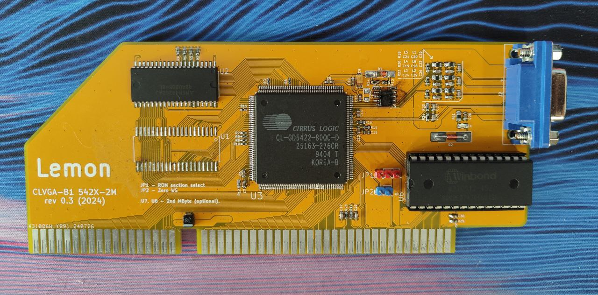

# Helios
CL-GD542x-based ISA VGA card.

ISA видео карта на чипе Cirrus Logic GD542x (5422-5429).
Поддерживаются конфигурации с одним/двумя/четырьма чипами памяти (512Kb, 1Mb, 2Mb). 
Тестировался режим пока только с 512Kb. Плата может содержать еше ошибки.

## Specification
- Быстрая работа с памятью в MS-DOS
- Полностью VGA совместима
- встроенный True Color RAMDAC
- Три возможных варианта конфигурации памяти в зависимости от используемого чипа (512Kb/1Mb/2Mb) 
- 16-bit ISA двухслойная плата

## Configuration
- R9-R14 - конфигурационные резисторы
    - R9 - zero WS BIOS (кроме 5429),
    - R10 - 3C3/4E68 sleep port,
    - R11, R12 - DRAM Speed (50/44/41/38 MHz),
    - R13 - DRAM timing,
    - R14 - DRAM multi CAS/WE

    По умолчанию устанавливаются все резисторы кроме R10 (и R9 для 5429). 
    Более подробно в документации на видеочип.
- 512Kb/1Mb/2Mb Video RAM
    - 512Kb - U1 - для чипов 5422-5424
    - 1Mb - U1-U2 - для чипов 5422-5429
    - 2Mb - U1-U4 - для чипов 5426-5429
- устанавливается только одна микросхема U5 или 'U5 
- JP5-JP9 - конфигурационные перемычки
    - JP5 - использовать IRQ2,
    - JP6 - zero WS ISA,
    - JP7 - BIOS ROM section select,
    - JP8-JP9 - MEMR/EROM/GND as ROM read.

    По умолчанию устанавливается перемычка JP6 и запаивается EROM или GND.
- в качестве источника 14.318MHz может использоваться сигнал BOSC с ISA шины (устанавливается R16) или собственный генератор (устанавливается Y1 и C17/C18).

## Notes 

Использование оригинальных BIOS невозможно. Оригинальное содержимое микросхем BIOS расчитано на возможность использования их в 16-ти битном режиме.
У них младший бит используется в качестве самого старшего бита адреса микросхемы для переколючения половин содержимого (подробно в документации). 
В данной конструкции используется плоская адресация и требуется конвертация BIOS файлов.

## Changes

- Version 1.2.5
    - оптимизация расположения элементов,
    - все конденсаторы меньше чем 0.1u заменены на 0805.
- Version 1.2.2
    - оптимизация расположения элементов,
    - изменена нумерация элементов.
- Version 0.7
    - добавлен альтернативный футпринт (hc49) для собственного генератора на 14.318Mhz.
- Version 0.5
    - добавлена возможность использовать собственный генератор на 14.318Mhz (5032 2-pin),
    - добавлена возможность использовать в качестве источника опорного напряжения LM334SM (с другой распиновкой),
    - исправлена разводка шины данных к BIOS,
    - добавлены согласующие резисторы по адресной шине между видеочипом и памятью,
    - изменена нумерация элементов.
- Version 0.3
    - первая версия реализованная в железе (кодовое имя - Lemon),
    - перепутана шина данных для BIOS D0-D7 -> D7-D0 (можно использовать конвертер для создания файла BIOS для данного варианта),
    - рабочая версия.

## Images
Изображения версии 0.3 в папке images/0.3

