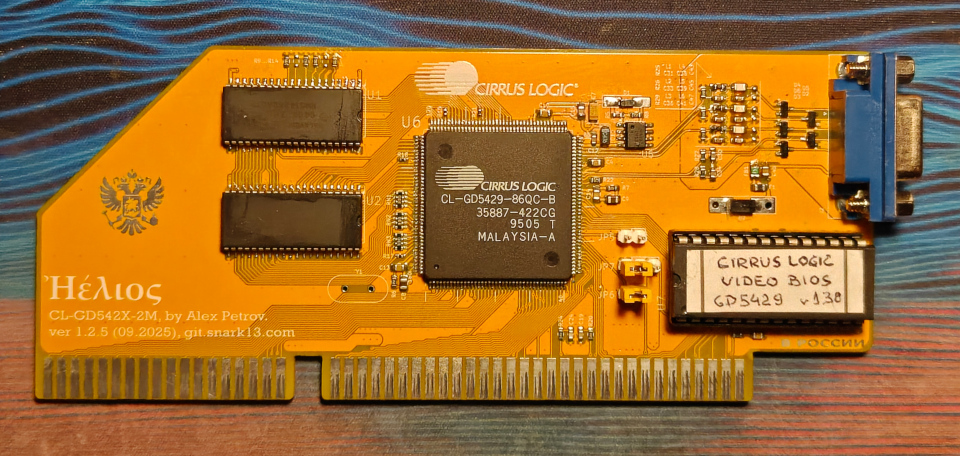
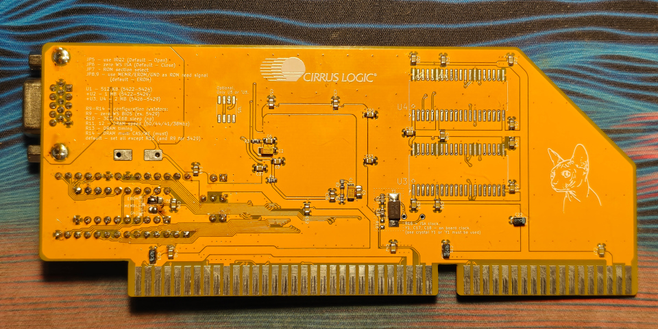

# Helios VGA Card

[Русская версия](README_RU.md)

Main project repository: [git.snark13.com/snark13/helios](https://git.snark13.com/snark13/helios.git).

GitHub mirror: [github.com/snark013/vga-clgd542x-helios](https://github.com/snark013/vga-clgd542x-helios).

Helios is a VGA graphics card for the 16-bit ISA bus, based on Cirrus Logic CL-GD542x chips (CL-GD5422–CL-GD5429). The project is designed in KiCad and uses a two-layer PCB.

## Project status

The current schematic and PCB version is 1.2.7. The following configurations have been built and tested:

| PCB version | Graphics chip | Video memory |
| --- | --- | --- |
| 0.3 | CL-GD5422 | 512 KB |
| 1.2.5 | CL-GD5429 | 1 MB |

Other combinations of PCB revision, graphics chip, and memory capacity have not yet been tested.

Release files for version 1.2.7 are available in the repository. The test results above apply to versions 0.3 and 1.2.5.

## Key features

- VGA compatibility.
- Integrated video digital-to-analog converter (RAMDAC) with True Color support.
- Three video memory configurations: 512 KB, 1 MB, or 2 MB, depending on the graphics chip.
- Two-layer PCB for the 16-bit ISA bus.

## Video memory configurations

| Capacity | Chips to populate | Graphics chips |
| --- | --- | --- |
| 512 KB | U1 | CL-GD5422–CL-GD5424 |
| 1 MB | U1, U2 | CL-GD5422–CL-GD5429 |
| 2 MB | U1–U4 | CL-GD5426–CL-GD5429 |

This table lists the intended configurations. Configurations tested on hardware are listed under “Project status”.

## Project files

- [helios.kicad_pro](helios.kicad_pro) — KiCad project.
- [helios.kicad_sch](helios.kicad_sch) — schematic.
- [helios.kicad_pcb](helios.kicad_pcb) — PCB layout.
- [helios.pretty/](helios.pretty/) — local footprint library.
- [docs/](docs/) — reference documentation.
- [release/](release/) — release files and previous version files.
- [images/1.2.5/](images/1.2.5/) — photos of the assembled version 1.2.5 board.

### Release files

| Version | Gerber files | Schematic | Interactive bill of materials |
| --- | --- | --- | --- |
| 1.2.7 | [ZIP](release/1.2.7/helios-1.2.zip) | [PDF](release/1.2.7/helios.pdf) | [HTML](release/1.2.7/ibom.html) |
| 1.2.5 | [ZIP](release/1.2.5/helios.zip) | [PDF](release/1.2.5/helios.pdf) | [HTML](release/1.2.5/ibom.html) |

## Configuration and assembly

Component references below apply to the current revision unless stated otherwise. Check the configuration input settings against the [CL-GD542x Technical Reference Manual](docs/CL-GD542X_Technical_Reference_Manual_Jan1994.pdf) for the graphics chip being used.

### Configuration resistors

| Reference | Function |
| --- | --- |
| R9 | Zero-wait-state BIOS access (except CL-GD5429) |
| R10 | Sleep control port selection: 3C3h / 4E68h |
| R11, R12 | DRAM clock selection: 50 / 44 / 41 / 38 MHz |
| R13 | DRAM timing configuration |
| R14 | DRAM multi CAS/WE configuration |

By default, fit all resistors listed above except R10.

### Current reference

Fit only one of the two alternatives: **U5 or U5′**. These options use LM334 devices with different pinouts; select the appropriate package when assembling the board.

### Configuration jumpers

| Reference | Function |
| --- | --- |
| JP5 | Enable IRQ2 |
| JP6 | Zero-wait-state ISA operation |
| JP7 | BIOS ROM section selection |

JP6 is fitted by default.

Revisions earlier than 1.2.7 also include JP8 and JP9 to select the ROM read signal (MEMR / EROM / GND). On those boards, connect JP9 to ground. JP8 and JP9 have been removed starting with revision 1.2.7.

### Clock source

Two options are provided for the 14.318 MHz clock:

- ISA bus BOSC signal: fit R16.
- On-board oscillator: fit Y1, C17, and C18.

## BIOS preparation

A BIOS image from another graphics card may need conversion before it can be programmed into the Helios ROM.

Many original boards use a BIOS arranged for 16-bit operation with two ROM chips. The least significant address bit is used as the chip’s most significant address bit to switch between the two halves of its contents. This arrangement is described in the graphics chip documentation.

Helios uses linear (“flat”) addressing, so images with a different address arrangement must be converted. Some original boards already use linear addressing; their images do not require this conversion.

Revision **0.3** also has the BIOS data lines connected in reverse order: D0–D7 are wired as D7–D0. Images prepared for this revision must also have the bit order reversed within each byte.

## Revision history

### 1.2.7

- Corrected the mislabeled U8 device type from 74LS541 to 74LS245.
- Removed JP8 and JP9.
- Removed unnecessary PCB markings and corrected inaccurate ones.

### 1.2.5

- Optimized component placement.
- Changed all capacitors below 0.1 µF to the 0603 package.
- Added diode protection to the VGA output lines.
- Built the second working board version.

### 1.2.2

- Optimized component placement.
- Renumbered components.

### 0.7

- Added an alternative HC-49 footprint for the 14.318 MHz oscillator.

### 0.5

- Added support for an on-board 14.318 MHz oscillator (two-pin 5032 package).
- Added support for the LM334SM with an alternative pinout as a current reference.
- Corrected the BIOS data bus routing.
- Added termination resistors to the address bus lines between the graphics chip and memory.
- Renumbered components.

### 0.3

- Built the first working board, codenamed Lemon.
- Identified the reversed BIOS data line order (D0–D7 → D7–D0); the BIOS image requires a corresponding conversion.

## Photos

Assembled version 1.2.5 board.

[Photo of the revision 0.3 board](images/0.3/build-0.3.jpg).
