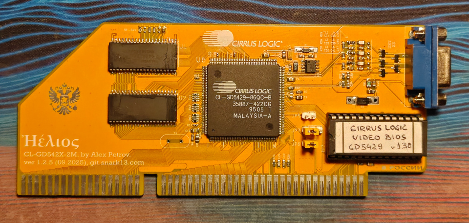
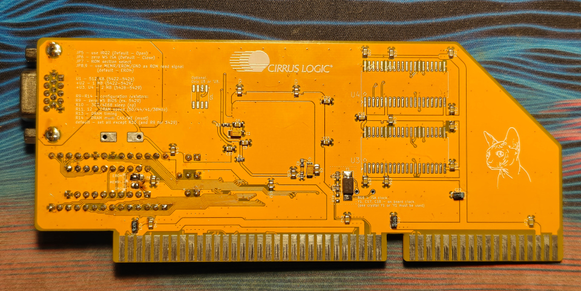

# Helios — видеокарта ISA VGA

[English version](README.md)

Основной репозиторий проекта: [git.snark13.com/snark13/helios](https://git.snark13.com/snark13/helios.git).

Зеркало на GitHub: [github.com/snark013/vga-clgd542x-helios](https://github.com/snark013/vga-clgd542x-helios).

Helios — видеокарта для 16-разрядной шины ISA на базе Cirrus Logic CL-GD542x (CL-GD5422–CL-GD5429). Проект выполнен в KiCad и использует двухслойную печатную плату.

## Состояние проекта

Текущая версия схемы и платы — 1.2.7. Собраны и проверены следующие конфигурации:

| Версия платы | Видеочип | Видеопамять |
| --- | --- | --- |
| 0.3 | CL-GD5422 | 512 КБ |
| 1.2.5 | CL-GD5429 | 1 МБ |

Остальные сочетания ревизий платы, видеочипов и объёмов памяти пока не проверены.

Материалы выпуска 1.2.7 доступны в репозитории. Сведения об испытаниях выше относятся к версиям 0.3 и 1.2.5.

## Основные характеристики

- Совместимость с VGA.
- Встроенный в видеочип цифро-аналоговый преобразователь видеосигнала (RAMDAC) с поддержкой True Color.
- Три конфигурации видеопамяти: 512 КБ, 1 МБ или 2 МБ в зависимости от видеочипа.
- Двухслойная печатная плата для 16-разрядной шины ISA.

## Конфигурации видеопамяти

| Объём | Устанавливаемые микросхемы | Видеочипы |
| --- | --- | --- |
| 512 КБ | U1 | CL-GD5422–CL-GD5424 |
| 1 МБ | U1, U2 | CL-GD5422–CL-GD5429 |
| 2 МБ | U1–U4 | CL-GD5426–CL-GD5429 |

Таблица описывает предусмотренные конфигурации. Проверенные на практике варианты перечислены в разделе «Состояние проекта».

## Файлы проекта

- [helios.kicad_pro](helios.kicad_pro) — проект KiCad.
- [helios.kicad_sch](helios.kicad_sch) — принципиальная схема.
- [helios.kicad_pcb](helios.kicad_pcb) — печатная плата.
- [helios.pretty/](helios.pretty/) — локальная библиотека посадочных мест.
- [docs/](docs/) — справочная документация.
- [release/](release/) — материалы выпусков и файлы предыдущих версий.
- [images/1.2.5/](images/1.2.5/) — фотографии собранной платы версии 1.2.5.

### Материалы выпусков

| Версия | Gerber-файлы | Схема | Интерактивный список компонентов |
| --- | --- | --- | --- |
| 1.2.7 | [ZIP](release/1.2.7/helios-1.2.zip) | [PDF](release/1.2.7/helios.pdf) | [HTML](release/1.2.7/ibom.html) |
| 1.2.5 | [ZIP](release/1.2.5/helios.zip) | [PDF](release/1.2.5/helios.pdf) | [HTML](release/1.2.5/ibom.html) |

## Конфигурация и сборка

Обозначения компонентов ниже относятся к текущей ревизии, если не указано иное. Параметры конфигурационных входов следует сверять с [техническим руководством CL-GD542x](docs/CL-GD542X_Technical_Reference_Manual_Jan1994.pdf) для используемого видеочипа.

### Конфигурационные резисторы

| Обозначение | Назначение |
| --- | --- |
| R9 | Доступ к BIOS без тактов ожидания (кроме CL-GD5429) |
| R10 | Выбор порта управления режимом сна: 3C3h / 4E68h |
| R11, R12 | Выбор частоты DRAM: 50 / 44 / 41 / 38 МГц |
| R13 | Настройка временных параметров DRAM |
| R14 | Настройка режима DRAM multi CAS/WE |

По умолчанию устанавливаются все перечисленные резисторы, кроме R10.

### Источник опорного тока

Устанавливается только один из двух альтернативных вариантов: **U5 или U5′**. Варианты используют LM334 с разной распиновкой; при сборке необходимо учитывать выбранный корпус.

### Конфигурационные перемычки

| Обозначение | Назначение |
| --- | --- |
| JP5 | Использование IRQ2 |
| JP6 | Работа с ISA без тактов ожидания |
| JP7 | Выбор области ПЗУ BIOS |

По умолчанию устанавливается перемычка JP6.

В ревизиях до 1.2.7 также предусмотрены JP8 и JP9 для выбора сигнала чтения ПЗУ (MEMR / EROM / GND). На этих платах JP9 следует замкнуть на землю. Начиная с ревизии 1.2.7 перемычки JP8 и JP9 удалены.

### Источник тактового сигнала

Предусмотрены два варианта получения частоты 14,318 МГц:

- Сигнал BOSC с шины ISA: устанавливается R16.
- Собственный генератор на плате: устанавливаются Y1, C17 и C18.

## Подготовка BIOS

Образ BIOS от другой видеокарты может потребовать преобразования перед записью в ПЗУ Helios.

Во многих исходных платах BIOS рассчитан на 16-разрядную организацию с двумя микросхемами ПЗУ. Младший разряд адреса используется как старший адресный разряд микросхемы для переключения между половинами её содержимого. Подробнее эта организация описана в документации на видеочип.

В Helios используется линейная («плоская») адресация, поэтому образ с другой организацией адресов необходимо преобразовать. Некоторые исходные платы уже используют линейную адресацию; для таких образов это преобразование не требуется.

У ревизии **0.3** дополнительно перепутан порядок линий данных BIOS: D0–D7 подключены как D7–D0. При подготовке образа для этой ревизии необходимо также изменить порядок битов в каждом байте.

## История изменений

### 1.2.7

- Исправлено ошибочное обозначение типа U8: 74LS245 вместо 74LS541.
- Удалены перемычки JP8 и JP9.
- Удалены лишние и исправлены некорректные надписи на плате.

### 1.2.5

- Оптимизировано расположение компонентов.
- Для всех конденсаторов ёмкостью менее 0,1 мкФ выбран типоразмер 0603.
- Добавлена диодная защита выходных линий VGA.
- Собран второй работающий вариант платы.

### 1.2.2

- Оптимизировано расположение компонентов.
- Изменена нумерация компонентов.

### 0.7

- Добавлено альтернативное посадочное место HC-49 для генератора на 14,318 МГц.

### 0.5

- Добавлена возможность установки собственного генератора на 14,318 МГц (двухвыводной корпус 5032).
- Добавлена возможность использования LM334SM с альтернативной распиновкой в качестве источника опорного тока.
- Исправлена разводка шины данных BIOS.
- Добавлены согласующие резисторы в линии адресной шины между видеочипом и памятью.
- Изменена нумерация компонентов.

### 0.3

- Собран первый работающий вариант платы под кодовым именем Lemon.
- Обнаружен обратный порядок линий данных BIOS (D0–D7 → D7–D0); требуется соответствующее преобразование образа BIOS.

## Фотографии

Собранная плата версии 1.2.5.

[Фотография платы ревизии 0.3](images/0.3/build-0.3.jpg).
